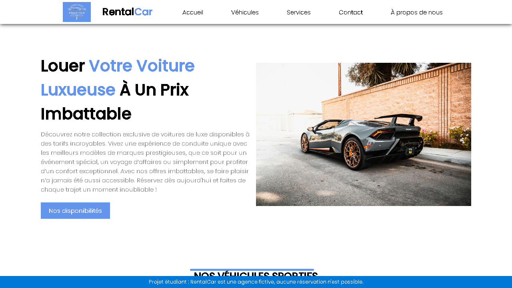

# 🚗 RentalCar

> Site vitrine d'une agence fictive de location de voitures de luxe, réalisé en HTML, CSS et jQuery.




> **Site fictif :** aucune réservation n'est possible. Les adresses, les téléphones et les tarifs sont inventés. Les photos de voitures et le logo proviennent de sites d'images gratuits.

## ✨ Les pages

| Page | Contenu |
|---|---|
| **Accueil** | Présentation, gammes de véhicules, services, carte de France cliquable et formulaire de contact |
| **Véhicules** | Grille tarifaire par marque et tarifs des assurances |
| **Réservation** | Formulaire de réservation et disponibilités des agences de Metz et de Paris |
| **À propos** | Mission et histoire de l'agence |

## 🧠 Ce que le projet met en œuvre

- **Mise en page en Flexbox** : en-tête fixe, cartes de véhicules, pied de page toujours en bas.
- **Carte cliquable** : une image de la France avec des zones `<map>` et `<area>` qui mènent aux disponibilités de chaque agence.
- **Tableaux** : cellules fusionnées avec `colspan` et `rowspan` pour les grilles tarifaires.
- **Formulaires** : listes, dates, heures et boutons radio, sans envoi de données.
- **Effets en jQuery** : textes qui se déplient avec `slideToggle` et menu pour téléphone.
- **Petits écrans** : page d'accueil adaptée avec des media queries.
- **Navigation par ancres** : défilement fluide vers les sections et les marques.

## 🚀 Voir le site

**[Ouvrir le site en ligne](https://nassimseguer.github.io/rentalcar-site/)**

Pour le consulter sur son ordinateur, il suffit d'ouvrir `index.html` dans un navigateur : aucune installation n'est nécessaire.

## 🗂️ Organisation

```
├── index.html                      page d'accueil, ouverte par défaut
├── Rental_Car_accueil.html         même page, pour le lien « Retour à l'accueil »
├── Rental_Car_Vehicule.html        grille tarifaire
├── Rental_Car_formulaire.html      réservation et disponibilités
├── Rental_Car_Aproposdenous.html   présentation de l'agence
├── style-*.css                     une feuille de style par page
└── images/                         logos et photos
```

## 👤 Auteur

**Nassim Seguer**, étudiant en L3 Informatique à l'UFR MIM de Metz · [LinkedIn](https://linkedin.com/in/nassim-seguer)

*Projet réalisé en L1 Informatique (novembre 2024), sous la supervision de M. Bertolo. Avant sa publication, les liens, le menu pour téléphone, les tarifs et le poids des images ont été corrigés.*
